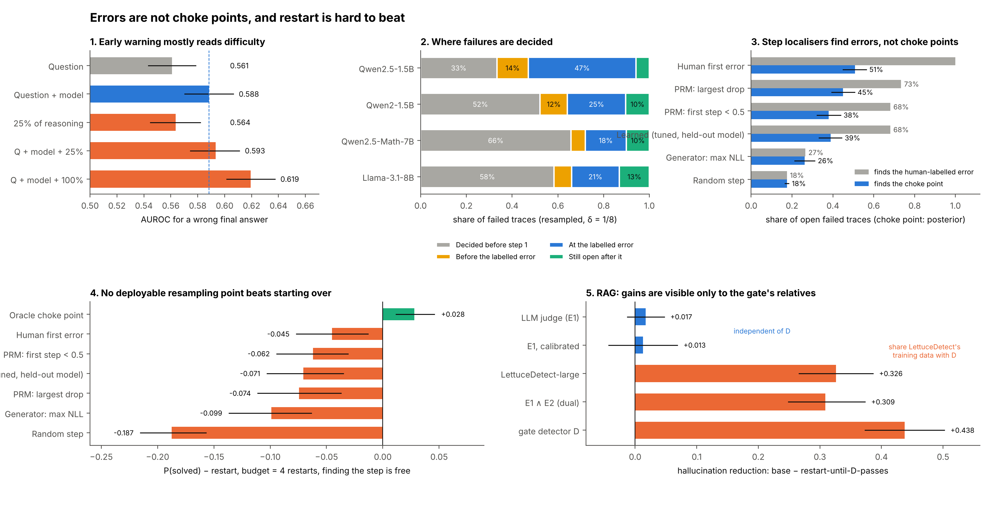
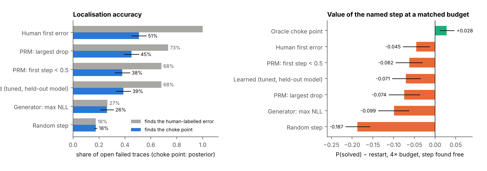

# Errors Are Not Choke Points

### Where LLM failures are decided, and why restarting is so hard to beat

**Harsh Dubey, Harshit Saini, Prashant Jain, Himanshu Kumar, Gaurav Kaushal, Rohit Chaudhary**
· Dept. of CSE (AI&ML), KIET Group of Institutions · [Paper (PDF)](paper/main.pdf) ·
[The research story (PDF)](docs/story/story.pdf) ·
[ChokeBench](#chokebench-a-new-benchmark) · [Reproduce](#reproduce-every-number)


> Process reward models, verifier-guided search and hallucination-repair loops all assume that a
> failing generation goes wrong at an identifiable step, and that resampling from just before
> that step beats starting over. We measured where failures are actually decided, with
> **125,832 on-policy continuations** in maths and **11,320** in retrieval-augmented generation.
> The step where a human sees the first error is the decisive step only about half the time,
> verifiers find the human label rather than the decisive step, and **no deployable choice of where
> to resample reliably beats a plain restart at matched compute**, in either domain.



*Preprint, not peer-reviewed. Every number on this page and in the paper is computed by the code in
this repository from committed data. Each claim is labelled **preregistered**, **exploratory** or
**confirmatory** (a preregistered test on new data), and results that failed are reported as such.*

---

## The question, and the one quantity that answers it

When a model fails mid-generation, where is the outcome decided, and what should a system do about
it? We answer with a single measurement. For a trace written by model *M*, let

&nbsp;&nbsp;&nbsp;&nbsp;**v<sub>k</sub> = P<sub>M</sub>(correct | question, first k steps)**

estimated by sampling *M*'s own continuations of the prefix. Then *restart* means resampling
from k = 0, *backtracking to step j* means resampling from k = j − 1, and the **choke point** is
where v collapses. An **error** is where a human annotator says reasoning first goes wrong. The
whole study asks whether the two coincide, whether anything can find either, and whether finding
them pays.

This is the restart-versus-continue problem of randomised search (Luby, Sinclair and Zuckerman
1993; Gomes et al. 2000), posed for language-model decoding, and the answer turns out to be the same: restarts are hard to beat.

## Five findings

| # | Finding | Key number | Evidence |
|---|---|---|---|
| 1 | **Early warning reads difficulty, not reasoning.** On 3,400 ProcessBench traces, the question and the generator's identity alone predict a wrong answer; the first quarter of the reasoning adds nothing and is at chance within a problem. | AUROC **0.588** from Q + model; +0.005 (n.s.) from 25% of the trace | exploratory |
| 2 | **Many failures are decided before the first step, and the rest are often decided at the labelled error.** Value curves replicate across independent sampling batches. | **33–66%** decided before step 1; labelled error = choke point in **0.44–0.65** of open failures vs a null of 0.16–0.20; r = **0.985** | preregistered; **confirmed** on Llama-3.1-8B (0.633 vs 0.187, Holm p < 0.002) |
| 3 | **Verifiers find errors, not choke points** (new: ChokeBench). A localiser trained and tuned for the choke point does no better. | a validated PRM finds **73%** of human first errors but **45%** of choke points; tuned learned localiser **39%** | exploratory |
| 4 | **No deployable resampling point reliably beats restart at matched compute.** Every token is charged, including verifier passes. The one exception is small: PRM backtracking on Qwen2.5-Math-7B at an 8× budget (+0.030, exploratory). Even a free oracle for the choke point gains little; a supermartingale argument explains why. | PRM-guided backtracking **−0.063** [−0.100, −0.024] vs restart (Llama); free oracle **+0.028** [+0.012, +0.046] | **confirmed** on Llama; theory in Appendix A |
| 5 | **The same holds for hallucinations in RAG**, and the size of any gain depends on who grades it. | commitment-aware choice adds **−0.000** [−0.005, +0.005]; restart's gain is **+0.326** to a grader related to its detector, **+0.017** (n.s.) to an independent one | preregistered (choice); exploratory (graders) |

## Benchmarks

### Maths: recovery policies at a matched budget

P(solved) for failed traces at a budget of **four restart attempts**, FLOP-matched, every
overhead charged (prefill, generated tokens, PRM passes, probes, oracle rollouts). Differences from
restart, 95% trace-bootstrap CIs. Verifier: Qwen2.5-Math-PRM-7B, re-validated here at ProcessBench
F1 73.2 (published 73.5).

| Policy | Qwen2.5-1.5B | Qwen2-1.5B | Qwen2.5-Math-7B | Llama-3.1-8B |
|---|---|---|---|---|
| **Restart** (P(solved)) | **0.657** | **0.514** | **0.437** | **0.492** |
| PRM: resample before first step < 0.5 | −0.651 | −0.514 | −0.041 | −0.068 |
| PRM: resample before largest drop | −0.651 | −0.514 | −0.022 [−0.052, +0.010] | **−0.063** [−0.100, −0.024] |
| PRM largest drop, verifier pass free (exploratory) | −0.061 | −0.098 | +0.046 | +0.003 |
| Probe search | −0.646 | −0.448 | −0.428 | −0.489 |
| Learned restart point (trained on other models) | −0.657 | −0.514 | −0.151 | −0.187 |
| *Human first error (oracle label, not deployable)* | *−0.047* | *−0.075* | *+0.039* | *+0.001* |

On the 1.5B models a 7B verifier pass costs about five generator attempts, so every verifier-based
policy runs out of budget. The only positive estimate under full accounting is PRM largest drop on
Qwen2.5-Math-7B at an 8× budget: +0.030 [+0.003, +0.057] (exploratory). Llama rows for PRM largest drop and the learned policy are
**confirmatory**; the rest are exploratory. Details: [paper §6](paper/main.pdf),
[`results/commitment/policies/`](results/commitment/policies).

### ChokeBench: a new benchmark

ProcessBench asks a verifier to find the human-labelled first error. **ChokeBench** also asks it to
find the **choke point**, the step where the generator's own success probability collapses, and
scores what the named step is worth as a resampling point. 230 open failed traces from four
generators; ground truth from the released rollouts with a Bayesian posterior so sampling noise is
not counted as a miss; selection and scoring on independent halves of the continuations.

| Localiser | finds human first error | finds choke point | Δ vs restart, per attempt | Δ vs restart at 4× budget, step found free |
|---|---|---|---|---|
| Human first error (expert label) | 1.00 | 0.51 [0.45, 0.56] | -0.066 [-0.105, -0.029] | -0.045 [-0.077, -0.013] |
| PRM: first step < 0.5 | 0.68 | 0.38 [0.32, 0.44] | -0.077 [-0.111, -0.043] | -0.062 [-0.094, -0.031] |
| PRM: largest drop | **0.73** | 0.45 [0.39, 0.51] | -0.103 [-0.145, -0.061] | -0.074 [-0.111, -0.037] |
| PRM: minimum | 0.61 | 0.39 [0.34, 0.45] | -0.158 [-0.201, -0.116] | -0.121 [-0.160, -0.085] |
| Learned, tuned (nested CV, held-out model) | 0.68 | 0.39 [0.33, 0.44] | -0.085 [-0.120, -0.050] | -0.071 [-0.103, -0.035] |
| Generator: max token NLL | 0.27 | 0.26 [0.21, 0.31] | -0.097 [-0.132, -0.063] | -0.099 [-0.137, -0.063] |
| Generator: max entropy | 0.30 | 0.28 [0.22, 0.33] | -0.178 [-0.219, -0.136] | -0.165 [-0.208, -0.124] |
| Random step | 0.18 | 0.18 | -0.224 | -0.187 |
| First step (= restart) | 0.14 | 0.28 | 0 | 0 |
| *Oracle choke point (held-out rollouts)* | – | – | *+0.015 [-0.010, +0.039]* | ***+0.028 [+0.012, +0.046]*** |

The learned localiser is trained for the choke point directly (soft posterior labels, 24
configurations of logistic regression and boosted trees selected by nested leave-one-generator-out
cross-validation) and still does no better than the fixed PRM rule: which step decides a failure is
model-specific. The last row is the ceiling for **any** backtracking verifier on these traces before its own cost
is paid: about three points. Before the choke point, a failed trace is worth about as much as a
fresh start, so finding the choke point saves tokens, not successes.

**Grade your own verifier:** [`results/chokebench/chokebench_v1.jsonl`](results/chokebench/chokebench_v1.jsonl)
holds, per failed trace, the per-prefix success and continuation counts, continuation lengths, the
human label and PRM scores. Name one step per trace and run
[`scripts/49_chokebench.py`](scripts/49_chokebench.py). Per-generator results:
[`results/chokebench/summary.md`](results/chokebench/summary.md).



### RAG: hallucination recovery under five graders

A recovery controller (CARE) gates on a hallucination detector *D* (LettuceDetect-base), then
repairs claims, resamples (choosing restart or backtrack by estimated recoverability) and finally
abstains or deletes. Preregistered test on RAGTruth (450 human-labelled sources) and HotpotQA (300
controlled-evidence items) with Llama-2-7B-chat, budget 2.

| Preregistered test (RAGTruth, primary judge E1) | Result | Verdict |
|---|---|---|
| H0: CARE vs base model | −0.047 [−0.072, −0.025], p = 0.0003 | supported |
| H1: CARE vs restart until *D* passes | −0.005 [−0.024, +0.013]; equivalent within ±0.03; restart uses 23% fewer tokens | not shown |
| H5: CARE vs CARE restricted to restarts (does the choice matter?) | **−0.000 [−0.005, +0.005]** | not shown: the mechanism adds nothing |
| Mechanism: resample before the first human-labelled hallucination vs restart | +0.024 [−0.002, +0.049] | not shown |
| Snowballing after a hallucinated sentence | −0.006 [−0.029, +0.019] | none |

Hallucination rate (%) on a held-out half of RAGTruth (233 sources) under five graders
([`scripts/50_evaluator_robustness.py`](scripts/50_evaluator_robustness.py)). Two graders never read
a LettuceDetect score; three share LettuceDetect's training data with the gate *D*:

| Policy | coverage | tokens | E1 judge | E1 calibrated | E2 | E1 ∧ E2 | D |
|---|---|---|---|---|---|---|---|
| Base model | 100.0 | 980 | 80.7 | 51.1 | 47.2 | 49.8 | 44.6 |
| Restart until *D* passes | 99.6 | 1,320 | 79.0 | 49.8 | 14.6 | 18.9 | 0.9 |
| CARE | 97.1 | 1,708 | 77.7 | 46.8 | 19.3 | 24.9 | 2.1 |
| CARE, restarts only | 96.8 | 1,710 | 77.3 | 45.1 | 18.5 | 23.6 | 2.1 |
| Abstain if flagged (QA) | 88.4 | 1,001 | 67.8 | 42.1 | 15.0 | 19.7 | 5.6 |
| Chain-of-Verification, revised answer (n = 98) | 100.0 | – | 71.4 | 43.9 | 41.8 | 42.9 | 30.6 |

Human agreement (Cohen's κ, held-out drafts): E1 0.24, E1 calibrated 0.19, E2 0.54, E1 ∧ E2 0.56
(threshold chosen on all drafts, so not out-of-sample), D 0.48.

**Reading.** CARE never beats restart under any grader. But how much a detector-gated loop helps
depends on whether the grader is a relative of the detector: the hallucination rate drops by
**32.6 points** according to LettuceDetect-large and by **1.7 points (n.s.)** according to the
independent judge. The independent judges are weak and cannot rule out a real effect; the related
ones are partly the gate grading itself. **Recovery loops should be graded by an evaluator that
shares no training data with the verifier**, and ultimately by people (a blinded two-rater kit is
in [`results/recovery/human_eval/`](results/recovery/human_eval)).

## What is new here

| Prior work | What it showed | What this study adds |
|---|---|---|
| ProcessBench (Zheng et al., ACL 2025); PRM lessons (Zhang et al. 2025) | human first-error labels; Monte Carlo labels disagree with them | measures the disagreement counterfactually at scale and shows which target verifiers actually track |
| Thought Anchors / Thought Branches (Bogdan, Macar et al. 2025) | resampling finds influential reasoning sentences | uses resampling to evaluate human labels, verifiers and recovery policies |
| Bulut 2026, *It's the problem, not the path* | early-signal AUROCs are mostly difficulty; prefixes vs matched restarts for reasoning models | difficulty control on human-annotated traces; failed traces, four generators, verifier costs charged |
| Qin et al. 2025, *To backtrack or not to backtrack* | trained backtracking beats best-of-n on deep search trees, not shallow ones | an upper bound on backtracking gains for failed on-policy traces, and the theory behind it |
| Snell et al. (ICLR 2025) | verifier search vs best-of-n depends on difficulty and budget | counterfactual ground truth for where a restart point should be |
| CoVe, RARR, LettuceDetect, RAGTruth | detect-then-revise hallucination repair | a preregistered test of *where* to resample, and an evaluator-dependence check |

Full positioning, with 2026 work: [`docs/RELATED_WORK.md`](docs/RELATED_WORK.md).

## Evidence levels: what was preregistered and what was found

- **Preregistered before any rollout** (`a6fb04c`): commitment categories, decisive step,
  sample-split backtracking, δ = 1/8 (1/16 and 1/4 as sensitivity).
- **Preregistered for the confirmatory run** ([`docs/PREREGISTRATION_RUN_C.md`](docs/PREREGISTRATION_RUN_C.md),
  `459ff22`): C1–C4 on Llama-3.1-8B (479 questions not in the Qwen traces), R1–R3 on three new
  sampling batches, the practical policies and their cost accounting.
- **Preregistered for Part 3** ([`docs/PREREGISTRATION_RECOVERY.md`](docs/PREREGISTRATION_RECOVERY.md)):
  H0–H5 at budget 2, judge validated against human labels, mechanism tests M1–M3.
- **Exploratory:** the difficulty and fatality analyses, ChokeBench, the evaluator comparison, and
  all policy results on Qwen models.

| Test | Result | Outcome |
|---|---|---|
| C1 restart > first error (Llama) | −0.022 [−0.090, +0.047] | not confirmed |
| C2 decisive step > first error (Llama) | +0.010 [−0.030, +0.058] | not confirmed |
| C3 decisive share > null (Llama) | +0.447 [+0.328, +0.569] | **confirmed** |
| C4 decisive ≡ restart within ±0.05 (Llama) | 90% CI [−0.008, +0.076] | inconclusive |
| R1 restart > first error on new batches | +0.140 [+0.078, +0.202] | **confirmed** |
| R2 / R3 measurement reliability | r = 0.985 / 0.976; stable decisive steps | **confirmed** |
| P2 / P4 practical policies vs restart (Llama) | −0.063 / −0.187 | both worse than restart |
| H1 / H5 recovery controller vs restart / vs its restart-only ablation | −0.005 / −0.000 | not shown (equivalent) |

## Per-model results (maths)

| | Qwen2.5-1.5B | Qwen2-1.5B | Qwen2.5-Math-7B | Llama-3.1-8B |
|---|---|---|---|---|
| continuations per step | 64 (4 batches) | 64 (4 batches) | 12 | 16 |
| fatal traces / not capability-limited | 51 / 34 | 67 / 32 | 207 / 71 | 144 / 60 |
| capability-limited fatal traces | 0.333 | 0.522 | 0.657 | 0.583 |
| first error = decisive step (null) | 0.647 (0.166) | 0.438 (0.204) | 0.423 (0.159) | 0.633 (0.187) |
| restart − first error, per attempt | +0.123 [+0.054, +0.197] | +0.165 [+0.067, +0.265] | +0.068 [+0.007, +0.133] | −0.022 [−0.090, +0.047] |
| decisive step − restart (TOST ±0.05) | −0.020 (equivalent) | −0.018 (inconclusive) | +0.040 (inconclusive) | +0.032 (inconclusive) |

"No difference detected" is never reported as "equal": equivalence is claimed only where a TOST
at ±0.05 passes.

## Reproduce every number

```bash
python -m pip install -r requirements.txt
make story          # CPU, ~1 min: ChokeBench, evaluator robustness, Fig. 0, paper numbers, paper PDF
```

| Command | Hardware | What it does |
|---|---|---|
| `make decomposition` | CPU | difficulty controls, error fatality (finding 1) |
| `bash scripts/run_c_analysis.sh` | CPU | every preregistered maths analysis from committed rollouts |
| `make chokebench` | CPU | ChokeBench (finding 3) |
| `make evaluator-robustness` | CPU | Part 3 under five graders (finding 5) |
| `make choke-paper` | CPU | regenerates `paper/values.tex` from the result tables and compiles the PDF |
| `make test` | CPU | test suite, including planted-effect tests of the estimators |
| `bash scripts/kaggle_run_c.sh` | Kaggle 2× T4 | the maths GPU run (~11.5 h; resumable) |
| `bash scripts/kaggle_recovery.sh` | Kaggle 2× T4 | the RAG GPU run (resumable) |

The paper never types a result by hand: every number is a macro written by
[`paper/make_values.py`](paper/make_values.py) from the result tables.

## Repository map

| Path | Contents |
|---|---|
| `paper/` | the paper (`main.pdf`), its sections, `make_values.py` |
| `results/commitment/`, `results/run_c/` | maths rollouts, PRM and generator step signals, forced-answer probes, analysis tables |
| `results/chokebench/` | ChokeBench release file, per-trace results, summary |
| `results/recovery/` | RAG generations, scores, judge verdicts, replay outputs, evaluator robustness, human-evaluation kit |
| `src/recovery/` | the recovery system: live controller, offline replay, statistics |
| `scripts/11`–`21` | maths analyses; `scripts/30`–`42` RAG pipeline; `scripts/49`–`51` ChokeBench, graders, summary figure |
| `docs/` | preregistrations, methodology, full results, related work |

## Limitations

- **Scale.** Four open models of at most 8B parameters for maths, one (Llama-2-7B-chat) for RAG.
  Llama-3.1-8B contributes 144 of its 274 fatal maths traces (time limit), and its RAG arm produced
  drafts only, so no recovery claim is made for it.
- **Near on-policy.** ProcessBench re-segmented the original solutions with unknown decoding
  settings, so prefixes are near-, not exactly, on-policy.
- **Graders.** The independent RAG judges agree only weakly with people (κ ≈ 0.2); no human rating of
  system outputs exists yet. Chain-of-Verification ran on 192 of 750 items.
- **Not yet done.** Two-coder human coding of recovered maths traces; human rating of RAG outputs.
  Both protocols and blinded sheets are released, and no result is reported until they are complete.

## Next steps

1. **Human ground truth for Part 3:** two raters on 80 blinded pairs (kit released; regenerate with a
   new seed first, see [its README](results/recovery/human_eval/README.md)).
2. **Reasoning models at scale:** the same value-curve protocol on long-CoT models (R1-distilled,
   Qwen3) where Bulut 2026 finds prefixes can beat restarts, to locate the boundary between the two
   regimes.
3. **Learned choke-point localisers** trained on ChokeBench, scored against the free-oracle ceiling.

## Corrections log

- **2026-10-27.** Commits `0ba841e`–`09dafdf` had added a "dual consensus judge", a six-baseline
  table and a "cross-model generalization" table that overstated the evidence: the judge's threshold
  was not chosen out-of-sample, the judge shares training data with the system's detector (which
  favours detector-gated policies), and the Llama-3.1 table reported detector flag rates, not
  recovery results. They are withdrawn; [`docs/RESULTS_RECOVERY.md`](docs/RESULTS_RECOVERY.md)
  explains and replaces them with the five-grader analysis above. The committed PDF had also not
  been rebuilt since Part 3 was added; it is now regenerated from the tables.

## Datasets, models and licences

| Resource | Source | Licence (as declared) | Role |
|---|---|---|---|
| ProcessBench | HF `Qwen/ProcessBench` (Zheng et al., ACL 2025) | Apache-2.0 | primary maths data |
| BIG-Bench Mistake | GitHub `WHGTyen/BIG-Bench-Mistake` | Apache-2.0 | transfer (E7) |
| GSM8K, MATH-500, MATH, OlympiadBench, Omni-MATH | HF `openai/gsm8k`, `HuggingFaceH4/MATH-500`, `EleutherAI/hendrycks_math`, `Hothan/OlympiadBench`, `KbsdJames/Omni-MATH` | see cards | gold answers |
| Qwen2.5-1.5B-Instruct, Qwen2-1.5B-Instruct, Qwen2.5-Math-7B-Instruct | HF `Qwen/...` | see model cards | generators |
| Llama-3.1-8B-Instruct | HF `unsloth/Meta-Llama-3.1-8B-Instruct` | Llama 3.1 Community License | generator |
| Qwen2.5-Math-PRM-7B | HF `Qwen/Qwen2.5-Math-PRM-7B` | see model card | process reward model |
| RAGTruth | GitHub `ParticleMedia/RAGTruth` (Niu et al., ACL 2024) | MIT | RAG benchmark with human spans |
| HotpotQA (distractor dev) | HF `hotpotqa/hotpot_qa` | CC BY-SA 4.0 | controlled-evidence RAG items |
| Llama-2-7B-chat | HF `NousResearch/Llama-2-7b-chat-hf` | Llama 2 Community License | RAG generator |
| LettuceDetect base / large | HF `KRLabsOrg/lettucedect-{base,large}-modernbert-en-v1` (Kovács & Recski 2025) | MIT | gate detector / grader |
| Qwen2.5-7B-Instruct | HF `Qwen/Qwen2.5-7B-Instruct` | Apache-2.0 | LLM judge |

## Citation

```bibtex
@misc{dubey2026chokepoints,
  title        = {Errors Are Not Choke Points: Where {LLM} Failures Are Decided, and Why
                  Restarting Is Hard to Beat},
  author       = {Dubey, Harsh and Saini, Harshit and Jain, Prashant and Kumar, Himanshu and
                  Kaushal, Gaurav and Chaudhary, Rohit},
  year         = {2026},
  howpublished = {\url{https://github.com/HarshDubey23/early-failure-detection-cot}},
  note         = {Dept. of CSE (AI\&ML), KIET Group of Institutions, Ghaziabad, India}
}
```

Supervised by Dr. Rohit Chaudhary (KIET Group of Institutions). GPU runs used free Kaggle notebooks.
Thanks to the ProcessBench, BIG-Bench Mistake, RAGTruth, HotpotQA, LettuceDetect, Qwen and Llama
teams for releasing data, models and weights.
