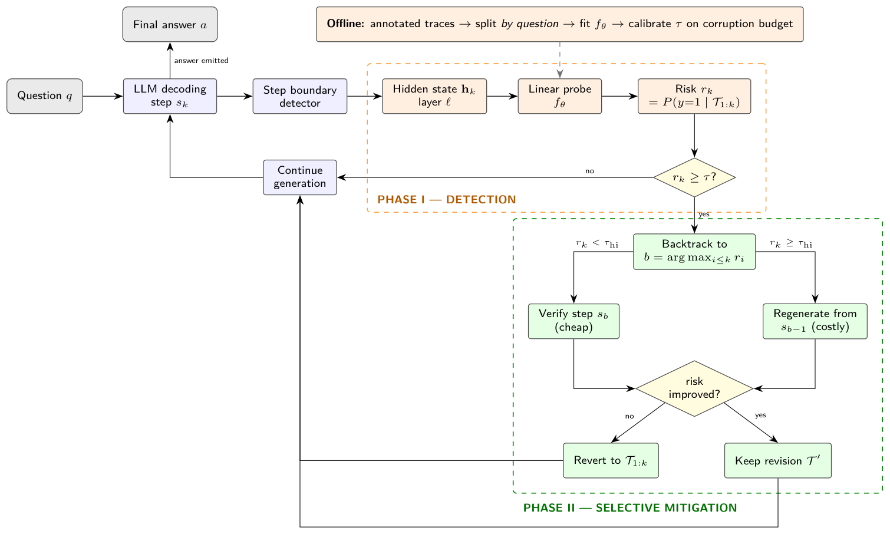

# Detecting and Mitigating Choke Points in Large Language Model Reasoning


When a language model reasons step by step and reaches a wrong answer, the mistake is
often made before the final step and then carried forward. This repository studies
where such first errors occur in reasoning trajectories and whether a detector that sees
only part of a trajectory can predict that the final answer will be wrong. It analyses
3,400 step-annotated solutions from ProcessBench, trains prefix-conditioned detectors on
held-out questions, measures detection lead time and calibration, tests transfer to
BIG-Bench Mistake, and replays a cost-aware selective-intervention policy offline. Every
number is computed by the pipeline; stages that could not run are reported as `NOT_RUN`.

## Headline result

From `docs/RESULTS.md` (full run of 2026-09-15; CPU only, so the GPU hidden-state
experiment E4 did not run):

- **Where errors start.** Mean relative onset rho = e/n is **0.500** (95% CI 0.490-0.510).
  A KS test against Uniform(0,1) rejects (D = 0.119, p = 1.2e-27), but that test would
  reject even for evenly placed errors because rho is discrete. Against the correct
  discrete null (error step uniform over each trace's own steps) the onset distribution
  still differs (p <= 0.001) and errors come **earlier** than that null predicts (0.500 vs
  0.578); in particular only 4.1% of first errors fall on the final step, versus 15.5%
  expected. A mean of **4.12** steps remain after the first error.
- **How early failure is predictable.** Predicting an incorrect final answer, a TF-IDF
  detector reaches AUROC **0.588** [0.552, 0.626] from 25% of the chain and **0.626**
  [0.590, 0.661] from the whole chain (question-level bootstrap intervals), against 0.618
  for surface features and 0.539 for trace length alone. In paired bootstrap tests it beats
  length-only from 25% onward (+0.073, p = 0.004 at 25%) but never significantly beats the
  surface detector. Over 5 independent grouped splits its AUROC at 25% averages 0.577
  (SD 0.015). A length-blind step-wise detector reaches 0.566 after one step.
- **Timing and transfer.** Step-wise alarms usually precede the first error, but at
  tau = 0.5 they also fire on 72.3% of error-free traces, so the warning is not specific.
  Trained on maths, the text detector is at or below chance on all five BIG-Bench Mistake
  tasks.

## Architecture



Vector source: `docs/diagrams/architecture.tex` (also Fig. 1 of the paper). Phase I
evaluates a detector at each step boundary; Phase II intervenes only when the risk
exceeds a calibrated threshold, escalating from verification to regeneration and
reverting revisions that do not reduce risk. The experimental pipeline is drawn in
`docs/diagrams/rendered/pipeline.pdf`, and a real ProcessBench trace with its first error
marked in `docs/diagrams/rendered/worked_example_processbench.pdf`.

## Installation

```bash
python -m pip install -r requirements.txt
```

Exact versions are pinned (tested on Python 3.13.3, Windows 11, CPU). A conda
alternative is `conda env create -f environment.yml`, which also installs Tectonic for
rendering diagrams and the paper. GPU stages 06-07 additionally need
`pip install -r requirements-gpu.txt` and a CUDA device.

On Windows use any GNU make (`mingw32-make`, Git for Windows, WSL). The Makefile calls
`python`; override with `make <target> PY=py` if needed.

## Quickstart - smoke test (about 1.5 minutes)

```bash
make smoke
```

Runs all ten stages on a small seeded synthetic corpus (no network, no GPU) and writes
everything under `results/smoke/`, including `results/smoke/RESULTS_SMOKE.md`. Those
numbers describe synthetic data only.

```bash
make test
```

47 tests, including the leakage test that checks every split in the code base.

## Full reproduction

```bash
make all
```

runs, in order (each stage prints a summary and `make` stops at the first failure):

| Target | Stage | Output |
|---|---|---|
| `make data` | 01 download ProcessBench, BIG-Bench Mistake, GSM8K questions; verify every dataset identifier | `data/raw/`, `results/tables/dataset_identifier_verification.json` |
| `make preprocess` | 02 rules P1-P5, question ids, quality report | `data/processed/*.jsonl` |
| `make eda` | 03-04 E1 onset + E2 tests | Table I, F1-F5 |
| `make baselines` | 05 E3 predictability curves | `table2_*`, F6, F7, F7b |
| `make activations` | 06 E4 generation + hidden states (skips without CUDA) | `data/processed/hidden_states_L*.npy` |
| `make probes` | 07 E4 layer x depth probes | `table3_*`, F8, F14 |
| `make analysis` | 08 E5 lead time, E6 calibration, E7 transfer | F9, F10, F13 |
| `make intervention` | 09 E8 simulated Algorithm 2 | F11, F12 |
| `make report` | 10 results report + paper values | `docs/RESULTS.md`, `results/paper_values.json` |

A clean full run (all outputs deleted first) took 7.7 minutes on the build machine's CPU.
`make diagrams` renders the TikZ figures, and `make paper` copies the paper figures into the
Overleaf package, checks that every `\RES{}` value in `main.tex` exists in
`results/paper_values.json`, and compiles the paper (both need Tectonic; set
`TECTONIC=/path/to/tectonic` if it is not on `PATH`).

## Repository map

| Path | Contents |
|---|---|
| `configs/` | `default.yaml` (full run), `quick.yaml` (smoke) - every hyperparameter, all keys required |
| `src/config.py` | typed, validated config loader |
| `src/data/` | loaders with a uniform `Trace` schema, identifier verification, P1-P6, segmentation, synthetic smoke data |
| `src/features/` | surface, lexical (TF-IDF), uncertainty, hidden-state extraction |
| `src/models/` | linear probe + layer x depth sweep, MLP and GRU probes, baselines |
| `src/analysis/` | onset (E1), statistics (E2), predictability (E3), lead time (E5), calibration (E6), transfer (E7) |
| `src/intervention/` | Algorithm 2 policy and offline simulator (E8) |
| `src/viz/` | one style module, one function per figure |
| `src/reporting/` | builds `RESULTS.md` and the paper value map |
| `scripts/01-10` | thin command-line stages |
| `tests/` | leakage, loaders, preprocessing, metrics, reproducibility |
| `results/tables/`, `results/figures/` | CSV + LaTeX tables; PNG (300 dpi) + PDF figures; `results/manifest.json` |
| `docs/` | METHODOLOGY, DESIGN_DECISIONS, RESULTS, LEARNING_NOTES, BENCHMARKS, diagrams |
| `notebooks/` | `00_walkthrough.ipynb` (narrated tour of saved results), `01_original_prototype.ipynb` |

## Results summary

| Experiment | Main quantity | Value |
|---|---|---|
| E1 | traces / with process error / with incorrect answer | 3,400 / 65.3% / 50.0% |
| E1 | mean rho [95% CI]; mean steps after first error | 0.500 [0.490, 0.510]; 4.12 |
| E2 | KS vs Uniform(0,1) | D = 0.119, p = 1.2e-27 |
| E2 | discrete null (errors uniform over steps) | D = 0.149 (null 95th pct 0.026), p <= 0.001; mean rho 0.500 vs 0.578 |
| E2 | Kruskal-Wallis across tiers | H = 14.50, p = 0.002, eta^2 = 0.005 |
| E3 | AUROC at 25% / 100%, lexical | 0.588 / 0.626 |
| E3 | AUROC at 100%: surface / length-only / MLP / GRU / majority | 0.618 / 0.539 / 0.626 / 0.558 / 0.500 |
| E3 | paired lexical - length-only / lexical - surface at 25% | +0.073 (p = 0.004) / +0.039 (p = 0.068) |
| E3 | lexical AUROC at 25% over 5 grouped splits | mean 0.577, SD 0.015, range 0.554-0.590 |
| E5 | length-blind AUROC after 1 / 6 observed steps | 0.566 / 0.613 |
| E4 | hidden-state probes | NOT_RUN (no GPU) |
| E5 | tau = 0.5: alarm rate erroneous / error-free; P(Delta > 0) | 0.908 / 0.723; 0.634 |
| E6 | ECE lexical / surface / MLP / GRU | 0.025 / 0.021 / 0.046 / 0.164 |
| E7 | lexical AUROC, ProcessBench test -> BBM tasks | 0.626 -> 0.172 to 0.502 |
| E8 | intervention | simulated under assumed parameters; see `RESULTS.md` |

Every value, with its confidence interval and source file, is in `docs/RESULTS.md`.

## Datasets and licences

| Dataset | Source | Licence (as declared) | Role |
|---|---|---|---|
| ProcessBench | HF `Qwen/ProcessBench` (Zheng et al., 2024) | Apache-2.0 | primary |
| BIG-Bench Mistake | GitHub `WHGTyen/BIG-Bench-Mistake` (Tyen et al., 2024) | Apache-2.0 | transfer |
| GSM8K | HF `openai/gsm8k` (Cobbe et al., 2021) | MIT | GPU generation (not run) |
| MATH-500 / MATH | HF `HuggingFaceH4/MATH-500`; `hendrycks/competition_math` is disabled on the Hub | see card | loader only |
| StrategyQA | HF `wics/strategy-qa` (Geva et al., 2021) | other | loader only |
| PRM800K | GitHub `openai/prm800k` (Lightman et al., 2023) | MIT | loader only |

Raw and processed datasets are not committed; `make data preprocess` recreates them.
Activation tensors are never committed; stage 06 writes SHA-256 checksums instead.
Details and verification status: `docs/BENCHMARKS.md`.

## Citation

```bibtex
@misc{chokepoints2026,
  title        = {Detecting and Mitigating Choke Points in Large Language Model Reasoning},
  author       = {Dubey, Harsh and Saini, Harshit and Jain, Prashant and Kumar, Himanshu and
                  Kaushal, Gaurav and Chaudhary, Rohit},
  year         = {2026},
  howpublished = {Code and results repository},
  note         = {Dept. of CSE (AI\&ML), KIET Group of Institutions, Ghaziabad, India}
}
```

The datasets and prior work used here should be cited from the paper's bibliography (30
references), including Zheng et al. (2024) ProcessBench and Tyen et al. (2024) BIG-Bench
Mistake.

A complete study and viva guide (every concept, the paper section by section, every code
file, a question bank) is in `docs/study_guide/study_guide.pdf`; its numbers are checked
against the result files like the paper's.

## Acknowledgements

Supervised by Dr. Rohit Chaudhary (KIET Group of Institutions). Built from the MSE-1 Colab prototype
(`notebooks/01_original_prototype.ipynb`) and the IEEE paper skeleton. Thanks to the
authors of ProcessBench and BIG-Bench Mistake for releasing step-annotated reasoning traces.
