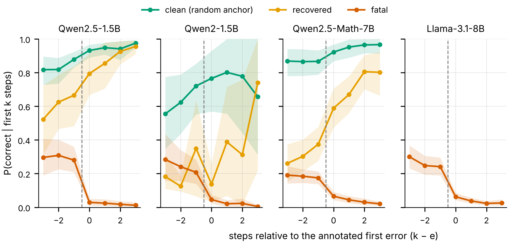

# Errors Are Not Choke Points: Difficulty, Error Onset and Counterfactual Commitment in LLM Reasoning Failures

> **Status: preprint draft, not peer-reviewed or submitted.** Every number below is computed by
> the code in this repository from real data: 3,400 expert-annotated ProcessBench solutions (CPU)
> and 50,152 model continuations sampled on GPU and committed as raw JSONL. The hidden-state
> experiment (E4) has not been run, and the intervention policy (E8) has only been replayed in an
> offline simulation. The repository was first titled "Detecting and Mitigating Choke Points in
> LLM Reasoning" and later "Where Reasoning Fails First"; the current title follows the evidence.


Process supervision assumes that the first incorrect step of a reasoning trace is where it
fails. Verifier-guided search backtracks to that step, and early-warning detectors assume that
failure is visible in a partial trace. This repository tests those assumptions. It first
controls failure detectors for problem difficulty. It then measures, by resampling the model
that wrote each trace, the step after which success actually becomes unlikely, and compares
that step with the human-annotated first error.

**Paper:** [`paper/main.pdf`](paper/main.pdf) (6 pages; every number in it is generated from the
result tables by `paper/make_values.py`).

## Key findings

**1. Early failure prediction is mostly a difficulty signal** (CPU, 3,400 traces, 5 seeds,
question-level cluster bootstrap).
- Question text plus generator identity alone predict a wrong answer with AUROC
  0.588 [0.570, 0.607].
- Adding the first 25% of the reasoning adds +0.005 (n.s.); the full chain adds
  +0.031 [0.020, 0.041].
- Within a problem, the 25% prefix is at chance (0.485).

**2. One first error in four is not fatal.**
- 521 of 2,221 annotated first errors (23.5%) still end in a correct answer (34% on Omni-MATH).
- Fatality does not depend on where the error occurs.
- Failure detectors rank these non-fatal errors as riskier than fatal ones (AUROC 0.456).

**3. Counterfactual commitment** (GPU, Kaggle 2x T4, vLLM). For every prefix of every trace,
the same model is sampled m times (temperature 0.7) and the success probability
v_k = P(correct | question, first k steps) is estimated.

| | Qwen2.5-1.5B-Instruct | Qwen2-1.5B-Instruct | Qwen2.5-Math-7B-Instruct |
|---|---|---|---|
| traces (clean / fatal / recovered) | 53 / 51 / 12 | 15 / 67 / 6 | 60 / 207 / 47 |
| continuations per prefix / total scored | 16 / 11,264 | 16 / 7,136 | 12 / 31,752 |
| fatal traces that are capability-limited (v_0 ≤ 1/8) | 0.333 | 0.522 | 0.657 |
| first error = largest drop in v (not capability-limited) | 0.529 [0.353, 0.706] | 0.344 [0.188, 0.531] | 0.423 [0.310, 0.535] |
| position-matched null | 0.171 | 0.214 | 0.159 |
| success: restart from scratch | 0.481 | 0.621 | 0.470 |
| success: resample from just before the first error | 0.375 | 0.406 | 0.402 |
| success: resample from just before the largest drop | 0.493 | 0.601 | 0.511 |
| **restart − first-error backtracking** | **+0.106 [+0.027, +0.187]** | **+0.215 [+0.095, +0.339]** | **+0.068 [+0.007, +0.133]** |
| largest-drop − first-error backtracking | +0.117 [+0.059, +0.183] | +0.196 [+0.082, +0.316] | +0.108 [+0.051, +0.165] |
| largest-drop − restart | +0.011 [−0.035, +0.061] | −0.020 [−0.057, +0.020] | +0.040 [−0.008, +0.089] |
| continuation tokens: restart / largest drop | 374 / 308 | 203 / 173 | 650 / 463 |

What the table shows:
- **33–66% of failures are decided before the first step.** The model almost never solves the
  problem from scratch, so no step is the choke point.
- **When the outcome is still open, the annotated error is often, but far from always, where
  it closes.** It is the largest drop in v in 34–53% of traces, against 16–21% expected by
  chance. For Qwen2-1.5B the interval includes the null.
- **Backtracking to the expert-labelled first error is worse than restarting from scratch, in
  all three models.** Even a perfect first-error verifier, used to choose where to resample,
  loses to a restart.
- **Resampling from just before the largest drop matches a restart with 15–29% fewer tokens.**
  Verifiers that steer search should be trained to find drops in success probability, not first
  errors.

Backtracking numbers use repeated sample splitting. Half of each prefix's continuations select
the trace and the target step, the other half score it. Results are averaged over 50 random
splits, with a trace bootstrap for the intervals. On a planted-effect simulation, where the
first error is the decisive step by construction, the estimator gives +0.001, so it does not
create a gap.




Success probability aligned at the annotated first error. Fatal traces collapse exactly at the
error. Recovered 7B traces become *more* likely to succeed across it. Clean traces, aligned at
a random step, drift smoothly.

Details:
- Difficulty controls and error fatality:
  [`docs/RESULTS_DECOMPOSITION.md`](docs/RESULTS_DECOMPOSITION.md).
- Counterfactual experiment, run log and final numbers:
  [`docs/COMMITMENT_EXPERIMENT.md`](docs/COMMITMENT_EXPERIMENT.md).
- Positioning against prior work: [`docs/NOVELTY_AUDIT.md`](docs/NOVELTY_AUDIT.md).

## Reproducing the results

```bash
python -m pip install -r requirements.txt
```

Exact versions are pinned (tested on Python 3.13.3, CPU). On Windows use any GNU make
(`mingw32-make`, Git for Windows, WSL); override the interpreter with `make <target> PY=py`.

| Command | Hardware | What it does |
|---|---|---|
| `make decomposition` | CPU, minutes | difficulty controls, error fatality, three-way AUROC (findings 1-2), Fig. 16-17 |
| `make commitment-analysis` | CPU, minutes | re-derives every counterfactual number and Fig. 18-20 from the committed raw rollouts in `results/commitment/` |
| `make choke-paper` | CPU | regenerates `paper/values.tex` from the tables and compiles `paper/main.pdf` (pdflatex) |
| `make commitment-mock` | CPU | runs stages 12-13 with a fake generator to check the pipeline; writes no results |
| `make commitment GENERATOR=... TP=... DTYPE=half` | GPU | samples new rollouts for one generator (stage 12) and analyses them (stage 13) |
| `make test` | CPU | 54 tests, including the leakage checks on every split and a planted-effect test of the commitment pipeline |

To re-run the GPU experiment on a free Kaggle notebook (2x T4):

```bash
git clone https://github.com/HarshDubey23/early-failure-detection-cot && cd early-failure-detection-cot
bash scripts/kaggle_commitment.sh setup     # math-verify + ProcessBench from Hugging Face
bash scripts/kaggle_commitment.sh vllm      # installs vLLM, removes the mismatched torchaudio
BACKEND=vllm bash scripts/kaggle_commitment.sh run Qwen2.5-1.5B-Instruct 16
bash scripts/kaggle_full.sh                 # the full three-model run used for the paper (~6 h on 2x T4)
```

T4s have no bfloat16, so everything runs in float16 with eager execution. Stage 12 appends to its
JSONL after every batch and resumes from it, so a session that times out can be continued.

## Repository map

| Path | Contents |
|---|---|
| `paper/` | `main.tex`, `counterfactual.tex`, `abstract.tex`, `refs.tex`, `make_values.py` (all numbers), `main.pdf` |
| `scripts/11_*`, `11b_*` | E9: difficulty controls and error-fatality decomposition (CPU) |
| `scripts/12_*`, `12a_*` | E10: counterfactual rollouts (vLLM / transformers / mock backends) and ProcessBench preparation |
| `scripts/13_*`, `13b_*` | E10: commitment analysis (categories, event study, sample-split backtracking) and figures |
| `scripts/kaggle_*.sh` | Kaggle drivers for the GPU runs |
| `results/commitment/` | raw rollouts (`<model>_s<shard>.jsonl`: every continuation's answer and correctness), run logs, `tables_<model>/` |
| `src/analysis/decomposition.py`, `commitment.py` | outcome groups, grouped cross-fitting, concordance; value curves, decisive step, point of no return |
| `configs/` | `default.yaml` (full run), `quick.yaml` (smoke) |
| `src/data/`, `src/features/`, `src/models/` | loaders with a uniform `Trace` schema, preprocessing, features, detectors and probes |
| `src/analysis/` (other) | onset (E1), statistics (E2), predictability (E3), lead time (E5), calibration (E6), transfer (E7) |
| `src/intervention/` | selective-intervention policy and offline simulator (E8) |
| `scripts/01-10` | the original ten-stage pipeline |
| `tests/` | leakage, loaders, preprocessing, metrics, reproducibility, commitment pipeline |
| `results/tables/`, `results/figures/` | CSV + LaTeX tables; PNG (300 dpi) + PDF figures |
| `docs/` | METHODOLOGY, DESIGN_DECISIONS, RESULTS, RESULTS_DECOMPOSITION, COMMITMENT_EXPERIMENT, NOVELTY_AUDIT, BENCHMARKS, diagrams |
| `notebooks/` | `00_walkthrough.ipynb` (narrated tour of saved results), `01_original_prototype.ipynb` |

## Original study (E1-E8)

The first version of this project studied where first errors occur and whether a partial trace
predicts a wrong answer. Those results are kept here as they were computed (full CPU run of
2026-09-15, `make all`; every value with its interval and source file is in
[`docs/RESULTS.md`](docs/RESULTS.md)). The difficulty controls above change how they should be
read: the 25% prefix AUROC of 0.588 equals what the question and generator alone achieve.

| Experiment | Main quantity | Value |
|---|---|---|
| E1 | traces / with process error / with incorrect answer | 3,400 / 65.3% / 50.0% |
| E1 | mean relative onset rho = e/n [95% CI]; mean steps after first error | 0.500 [0.490, 0.510]; 4.12 |
| E2 | discrete null (error uniform over each trace's steps) | p <= 0.001; mean rho 0.500 vs 0.578 (errors come earlier) |
| E2 | first errors on the final step, observed vs expected | 4.1% vs 15.5% |
| E3 | lexical (TF-IDF) AUROC at 25% / 100% of the chain | 0.588 / 0.626 |
| E3 | lexical − length-only at 25% (tie handling fixed) | +0.052 (p = 0.032); earlier reported as +0.073 |
| E3 | lexical AUROC at 25% over 5 grouped splits | mean 0.577, SD 0.015 |
| E4 | hidden-state probes | NOT_RUN (no GPU at the time) |
| E5 | tau = 0.5 alarm rate on erroneous / error-free traces | 0.908 / 0.723 |
| E6 | ECE lexical / surface / MLP / GRU | 0.025 / 0.021 / 0.046 / 0.164 |
| E7 | lexical AUROC, ProcessBench -> BIG-Bench Mistake tasks | 0.626 -> 0.172 to 0.502 |
| E8 | intervention | simulated under assumed parameters only |

```bash
make smoke   # all ten stages on seeded synthetic data (~1.5 min, no network, no GPU)
make all     # full original pipeline on real data (~8 min on CPU)
```


## Datasets, models and licences

| Resource | Source | Licence (as declared) | Role |
|---|---|---|---|
| ProcessBench | HF `Qwen/ProcessBench` (Zheng et al., ACL 2025) | Apache-2.0 | primary data |
| BIG-Bench Mistake | GitHub `WHGTyen/BIG-Bench-Mistake` (Tyen et al., 2024) | Apache-2.0 | transfer |
| GSM8K | HF `openai/gsm8k` | MIT | gold answers for rollouts |
| MATH-500 / MATH | HF `HuggingFaceH4/MATH-500`, `EleutherAI/hendrycks_math` | see card | gold answers for rollouts |
| OlympiadBench, Omni-MATH | HF `Hothan/OlympiadBench`, `KbsdJames/Omni-MATH` | see card | gold answers for rollouts |
| Qwen2.5-1.5B-Instruct, Qwen2-1.5B-Instruct, Qwen2.5-Math-7B-Instruct | HF `Qwen/...` | see model card | generators resampled in E10 |

Raw and processed datasets are not committed (`make data preprocess` recreates them); model
rollouts are committed because they are this project's own measurements.

## Citation

```bibtex
@misc{dubey2026chokepoints,
  title        = {Errors Are Not Choke Points: Difficulty, Error Onset and Counterfactual
                  Commitment in {LLM} Reasoning Failures},
  author       = {Dubey, Harsh and Saini, Harshit and Jain, Prashant and Kumar, Himanshu and
                  Kaushal, Gaurav and Chaudhary, Rohit},
  year         = {2026},
  howpublished = {\url{https://github.com/HarshDubey23/early-failure-detection-cot}},
  note         = {Dept. of CSE (AI\&ML), KIET Group of Institutions, Ghaziabad, India}
}
```

## Acknowledgements

Supervised by Dr. Rohit Chaudhary (KIET Group of Institutions). GPU runs used free Kaggle
notebooks. Thanks to the authors of ProcessBench and BIG-Bench Mistake for releasing
step-annotated reasoning traces, and to the Qwen team for open weights.
