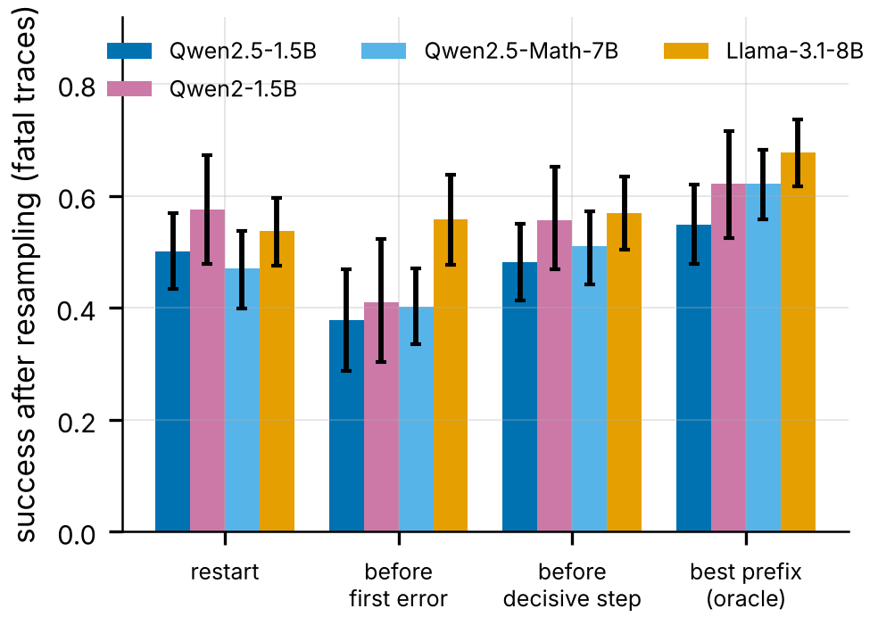
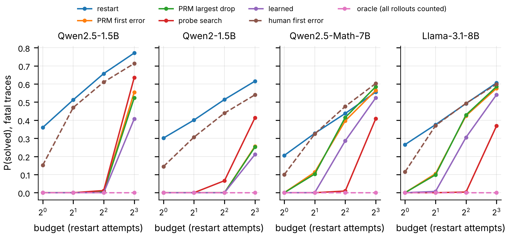

# Errors Are Not Choke Points: Where LLM Failures Are Decided, and What Recovery Can Do About It

> **Status: preprint draft, not peer-reviewed.** Every number is computed by the code here from
> real data:
> - 3,400 expert-annotated ProcessBench solutions (CPU);
> - 125,832 model continuations sampled on GPU and committed as raw JSONL;
> - 65,976 forced-answer probes;
> - process-reward-model scores for 3,374 traces.
>
> Claims carry an evidence level: **preregistered**, **exploratory** or **confirmatory** (a
> preregistered test on new data). Results that did not confirm are reported as such. What remains
> unverified is listed [below](#limitations-and-what-remains-unverified).


Process supervision assumes that the first incorrect step of a reasoning trace is where it fails,
and verifier-guided search backtracks to that step. This repository tests that assumption
counterfactually. We resample four open models from two families at every step of their own
ProcessBench traces and measure where success actually becomes unlikely. We then compare that
point with the human-annotated first error, and backtracking policies with simply restarting, at a
matched compute budget.

**Paper:** [`paper/main.pdf`](paper/main.pdf) (10 pages; every number in it is generated from the
result tables by `paper/make_values.py`).

## The research in one page

One question runs through three studies: **when a language model goes wrong mid-generation, where
is the outcome actually decided, and what should a system do about it?**

| Part | Question | Data | Answer |
|---|---|---|---|
| 1. Detection | Can partial reasoning predict failure? | 3,400 ProcessBench traces | Mostly no: question + generator explain it (difficulty) |
| 2. Commitment | Is the human-labelled first error where a solution becomes doomed? | 125,832 resampled continuations, four models | Often (42–65% vs a null of 0.16–0.20), but backtracking there loses to restarting for three of four models |
| 3. Recovery | Does recovery that targets where an answer is still recoverable reduce hallucinations? | RAGTruth + HotpotQA, 11,320 continuations, 8,803 judge verdicts | Reduces hallucination vs the base model, but does not beat plain restart at equal compute |

Every claim is labelled **preregistered**, **exploratory** or **confirmed on new data**, and the
negative results are reported as such.

## Key findings (Parts 1–2: math reasoning)

| # | Finding | Evidence |
|---|---|---|
| 1 | **Early failure prediction is mostly difficulty.** Question + generator alone predict a wrong answer with AUROC 0.588 [0.570, 0.607]; the first 25% of the reasoning adds +0.005 (n.s.) and is at chance within a problem. | exploratory, CPU |
| 2 | **One first error in four is not fatal** (23.5%), fatality is flat in error position, and failure detectors rank non-fatal errors as riskier than fatal ones (AUROC 0.456). | exploratory, CPU |
| 3 | **The counterfactual measurement is reliable.** Value curves from independent sampling batches correlate at r = 0.985 / 0.976. The decisive step's posterior mode is ≥ 0.5 in 87–100% of traces, so disagreement with human labels is not sampling noise. | confirmatory (R2, R3) |
| 4 | **33–66% of failures are decided before the first step**: the model almost never solves the problem from scratch. | preregistered categories |
| 5 | **When the outcome is still open, the annotated error is the step where success collapses in 42–65% of traces** (position-matched null 0.16–0.20). | preregistered (Qwen); **confirmed** on Llama (0.633 vs 0.187, Holm p < 0.002) |
| 6 | **Backtracking to the human first error is model-dependent.** For three Qwen models it is *worse than restarting* per attempt (by 0.07–0.17), and this replicates on 48 new continuations per step (+0.140 [+0.078, +0.202]). **It does not generalize to Llama-3.1-8B**: −0.022 [−0.090, +0.047], also with truncated outputs dropped. | exploratory → replicated (R1) → **not confirmed** on Llama (C1) |
| 7 | **No practical policy beats restart at a matched end-to-end budget** that counts every token, including verifier passes and probes. PRM-guided backtracking with a validated verifier (ProcessBench F1 73.2 vs published 73.5) is *worse* than restart for Llama (−0.063 [−0.100, −0.024]). A learned restart-point predictor transferred across families is worse everywhere. The only positive estimate is a small gain for Qwen2.5-Math-7B at large budgets or with a free verifier pass. | **confirmed** on Llama (P2, P4); exploratory elsewhere |
| 8 | **Why restart is hard to beat:** for on-policy traces, any restart point chosen without looking ahead is, per attempt and in expectation over failures, no better than starting over (a supermartingale argument, Appendix A). | theory |



Success after resampling a failed trace from each target, per attempt. Each step choice is made on
one half of the continuations and scored on the other; 50 splits; 95% CIs.



P(solved) for failed traces against the end-to-end budget, counted in restart attempts. The budget
is FLOP-matched and every overhead is charged.

## Evidence levels: what was preregistered and what was found

- **Preregistered before any rollout** (`a6fb04c`): the commitment categories, the decisive step,
  sample-split backtracking, δ = 1/8 (1/16 and 1/4 as sensitivity).
- **Exploratory (found in Runs A/B):** restart vs first-error backtracking, the position-matched
  null, repeated sample splitting, and the CPU difficulty and fatality analyses.
- **Preregistered for the confirmatory run** ([`docs/PREREGISTRATION_RUN_C.md`](docs/PREREGISTRATION_RUN_C.md),
  committed in `459ff22` before any Run C data):
  - C1–C4 on Llama-3.1-8B, whose traces cover 479 questions not in the Qwen traces;
  - R1–R3 on three new independent sampling batches;
  - the practical policies and their cost accounting.

  Outcomes, including the failures, are appended to the same file.

| Test | Result | Outcome |
|---|---|---|
| C1 restart > first error (Llama) | −0.022 [−0.090, +0.047] | not confirmed |
| C2 decisive step > first error (Llama) | +0.010 [−0.030, +0.058] | not confirmed |
| C3 decisive share > null (Llama) | +0.447 [+0.328, +0.569] | confirmed |
| C4 decisive ≡ restart within ±0.05 (Llama) | 90% CI [−0.008, +0.076] | inconclusive |
| R1 restart > first error on new batches | +0.140 [+0.078, +0.202] | confirmed |
| R2 / R3 measurement reliability | r = 0.985 / 0.976; stable decisive steps | confirmed |
| P2 / P4 practical policies vs restart (Llama) | −0.063 / −0.187 | both worse than restart |

## Per-model results

| | Qwen2.5-1.5B | Qwen2-1.5B | Qwen2.5-Math-7B | Llama-3.1-8B |
|---|---|---|---|---|
| continuations per step | 64 (4 batches) | 64 (4 batches) | 12 | 16 |
| fatal traces / not capability-limited | 51 / 34 | 67 / 32 | 207 / 71 | 144 / 60 |
| capability-limited fatal traces | 0.333 | 0.522 | 0.657 | 0.583 |
| first error = decisive step (null) | 0.647 (0.166) | 0.438 (0.204) | 0.423 (0.159) | 0.633 (0.187) |
| restart − first error, per attempt | +0.123 [+0.054, +0.197] | +0.165 [+0.067, +0.265] | +0.068 [+0.007, +0.133] | −0.022 [−0.090, +0.047] |
| decisive step − restart (TOST ±0.05) | −0.020 (equivalent) | −0.018 (inconclusive) | +0.040 (inconclusive) | +0.032 (inconclusive) |
| PRM largest drop − restart, budget 4, all costs | −0.651 | −0.514 | −0.022 [−0.052, +0.010] | −0.063 [−0.100, −0.024] |
| human first error − restart, budget 4 | −0.047 | −0.075 | +0.039 | +0.001 |

"No difference detected" is never reported as "equal": equivalence is claimed only where a TOST
at ±0.05 passes. Details and every other number:
- [`docs/COMMITMENT_EXPERIMENT.md`](docs/COMMITMENT_EXPERIMENT.md) (counterfactual runs);
- [`docs/RESULTS_DECOMPOSITION.md`](docs/RESULTS_DECOMPOSITION.md) (difficulty and fatality);
- [`docs/NOVELTY_AUDIT.md`](docs/NOVELTY_AUDIT.md) (positioning).

## Part 3: recovering from hallucinations (Run R)

The commitment measurement is turned into a system: a recovery controller for
retrieval-augmented generation. When a hallucination detector flags a sentence, the controller
first tries claim repair. It then resamples, choosing between backtracking to just before the
flagged sentence and restarting by how recoverable each looks. Finally it abstains on questions
whose evidence is insufficient. It was **preregistered before any data**
([plan](docs/PREREGISTRATION_RECOVERY.md)) and evaluated on RAGTruth (450 sources) and HotpotQA
with controlled evidence (300 items), with Llama-2-7B-chat. The comparisons are the base model,
Chain-of-Verification and each fixed strategy, at a matched compute budget. An LLM judge from
another model family is the primary evaluator; it was validated against RAGTruth's human labels.

| Result (RAGTruth, budget 2x the draft) | Value | Evidence |
|---|---|---|
| Hallucinated outputs: base model → controller | 80.9% → 76.2% (−4.7 [−7.2, −2.5]) | preregistered, **supported** |
| Controller − plain restart until the detector passes | −0.5 [−2.4, +1.3]; restart costs 23% fewer tokens | preregistered, **not shown** (equivalent within ±3) |
| Controller − controller restricted to restarts (does the mechanism add value?) | −0.0 [−0.5, +0.5] | preregistered, **not shown** |
| Oracle choice of resampling point − restart-only | −1.5 | upper bound on what the mechanism could add |
| Chain-of-Verification (revised answer only) − controller | −10 [−18, −3], 192 items | exploratory: CoVe is better, at about 2x the tokens |
| First human-labelled hallucination: backtrack − restart | +2.4 [−0.2, +4.9]; +9.3 for summaries | preregistered mechanism test, n.s. |
| Snowballing after a hallucinated sentence | none detected | preregistered, not supported |

**Reading:**
- A detector-triggered regenerate-or-abstain loop reduces hallucinations.
- At equal compute, choosing *where* to resample by estimated recoverability does not beat simply
  restarting. The same "restart is hard to beat" result as the math study, now for
  hallucinations.

Full results, evaluator checks, latency and limitations:
[`docs/RESULTS_RECOVERY.md`](docs/RESULTS_RECOVERY.md). System and commands:
[`docs/RECOVERY_SYSTEM.md`](docs/RECOVERY_SYSTEM.md).


## Reproducing the results

```bash
python -m pip install -r requirements.txt
```

| Command | Hardware | What it does |
|---|---|---|
| `make decomposition` | CPU | difficulty controls, error fatality, three-way AUROC (findings 1–2) |
| `make commitment-analysis` | CPU | Run B numbers and Fig. 18–20 from the committed rollouts |
| `bash scripts/run_c_analysis.sh` | CPU | every preregistered Run C analysis from `results/run_c/` (confirmatory tests, replication, robustness, policies, PRM check, answer curves) |
| `python scripts/21_run_c_figures.py` | CPU | Fig. 21–23 |
| `make choke-paper` | CPU | regenerates `paper/values.tex` and compiles `paper/main.pdf` |
| `make test` | CPU | the test suite, including a planted-effect test of the commitment pipeline |
| `bash scripts/kaggle_run_c.sh` | Kaggle 2x T4 | the full GPU run (~11.5 h; `scripts/run_c_mode` selects smoke or full) |

GPU code paths: stage 12 (rollouts, vLLM), stage 14 (PRM and generator step signals), stage 15
(forced-answer probes). T4s have no bfloat16, so everything runs in float16 with eager execution.
Every stage appends results as it goes and resumes after an interruption.

## Repository map

| Path | Contents |
|---|---|
| `paper/` | `main.tex`, `counterfactual.tex`, `policies.tex`, `appendix.tex` (proposition, preregistered outcomes, sensitivity), `make_values.py`, `main.pdf` |
| `results/commitment/` | Run A/B rollouts and logs, `tables_*`, `robustness_*`, `policies/`, `answer_curves/`, `prm_check.json` |
| `results/run_c/` | Run C raw outputs: rollouts (new batches, Llama), PRM and generator step signals, forced-answer probes, logs |
| `results/coding/` | blinded sheets for human coding of recovered traces (protocol: `docs/CODING_PROTOCOL.md`) |
| `scripts/11*` | difficulty and fatality decomposition (CPU) |
| `scripts/12*`–`15` | GPU stages: rollouts, ProcessBench preparation, step signals, answer probes |
| `scripts/13*`, `16`–`21` | analysis: commitment, robustness, policies, coding agreement, PRM check, answer curves, figures |
| `scripts/kaggle_*.sh`, `run_c_analysis.sh` | GPU drivers and the Run C analysis runner |
| `docs/` | PREREGISTRATION_RUN_C, COMMITMENT_EXPERIMENT, RESULTS_DECOMPOSITION, CODING_PROTOCOL, NOVELTY_AUDIT, METHODOLOGY, RESULTS |
| `src/recovery/`, `scripts/30`–`40`, `scripts/kaggle_recovery.sh` | Part 3: hallucination-recovery system, generation, scoring, replay at matched budgets, mechanism study, figures |
| `results/recovery/` | Part 3: RAGTruth label analysis, raw generations and scores (`run/`), analysis outputs (`final/`) |
| `src/`, `scripts/01-10`, `tests/` | the original pipeline (E1–E8) and its tests |

## Limitations and what remains unverified

- **Coverage.** Four open models of at most 8B parameters, mathematics only.
  - Llama contributes 144 of its 274 fatal traces. The time limit ran out; traces were processed
    in a random order.
  - Llama's recovered and clean traces were not run.
- **On-policy approximation.** ProcessBench re-segmented the original solutions, and their
  decoding settings are unknown, so prefixes are near-, not exactly, on-policy.
- **Truncation.** For the larger models, 17% (Qwen2.5-Math-7B) and 29% (Llama) of continuations
  hit the 1,024-token cap without an answer. Treating them as missing changes no conclusion.
- **Equivalence.** Decisive-step backtracking and restart are shown equivalent (±0.05) only for
  Qwen2.5-1.5B and the pooled new batches.
- **Human coding.** The two-coder human coding of recovered traces has not been done yet. The
  protocol and blinded sheets are released, and no coding result is reported until it is complete.
- **Exploratory results.** The CPU analyses, the answer curves, the shared-verifier accounting
  and all policy results on Qwen models are exploratory.

## Original study (E1–E8)

The first version of this project studied where first errors occur and whether a partial trace
predicts a wrong answer. Those results are kept as they were computed (`make all`; details in
[`docs/RESULTS.md`](docs/RESULTS.md)). The difficulty controls above change how to read them: the
25%-prefix AUROC of 0.588 equals what question and generator achieve alone. The lexical −
length-only difference at 25% is +0.052 (p = 0.032) after a tie-handling fix, not +0.073. The
hidden-state probes (E4) were not run, and the intervention policy (E8) was only simulated.

## Datasets, models and licences

| Resource | Source | Licence (as declared) | Role |
|---|---|---|---|
| ProcessBench | HF `Qwen/ProcessBench` (Zheng et al., ACL 2025) | Apache-2.0 | primary data |
| BIG-Bench Mistake | GitHub `WHGTyen/BIG-Bench-Mistake` | Apache-2.0 | transfer (E7) |
| GSM8K, MATH-500, MATH, OlympiadBench, Omni-MATH | HF `openai/gsm8k`, `HuggingFaceH4/MATH-500`, `EleutherAI/hendrycks_math`, `Hothan/OlympiadBench`, `KbsdJames/Omni-MATH` | see cards | gold answers |
| Qwen2.5-1.5B-Instruct, Qwen2-1.5B-Instruct, Qwen2.5-Math-7B-Instruct | HF `Qwen/...` | see model cards | generators |
| Llama-3.1-8B-Instruct | HF `unsloth/Meta-Llama-3.1-8B-Instruct` (copy of the Meta release) | Llama 3.1 Community License | generator |
| Qwen2.5-Math-PRM-7B | HF `Qwen/Qwen2.5-Math-PRM-7B` | see model card | process reward model |
| RAGTruth | GitHub `ParticleMedia/RAGTruth` (Niu et al., ACL 2024) | MIT | Part 3 primary benchmark, human hallucination spans |
| HotpotQA (distractor dev) | HF `hotpotqa/hotpot_qa` | CC BY-SA 4.0 | Part 3 controlled-evidence benchmark |
| Llama-2-7B-chat | HF `NousResearch/Llama-2-7b-chat-hf` (copy of the Meta release) | Llama 2 Community License | Part 3 generator |
| LettuceDetect base / large | HF `KRLabsOrg/lettucedect-{base,large}-modernbert-en-v1` | MIT | Part 3 detector and secondary evaluator |
| Qwen2.5-7B-Instruct | HF `Qwen/Qwen2.5-7B-Instruct` | Apache-2.0 | Part 3 judge (primary evaluator) |

## Citation

```bibtex
@misc{dubey2026chokepoints,
  title        = {Errors Are Not Choke Points: Difficulty, Error Onset and Counterfactual
                  Commitment in {LLM} Reasoning Failures},
  author       = {Dubey, Harsh and Saini, Harshit and Jain, Prashant and Kumar, Himanshu and
                  Kaushal, Gaurav and Chaudhary, Rohit},
  year         = {2026},
  howpublished = {\url{https://github.com/HarshDubey23/early-failure-detection-cot}},
  note         = {Dept. of CSE (AI\&ML), KIET Group of Institutions, Ghaziabad, India}
}
```

## Acknowledgements

Supervised by Dr. Rohit Chaudhary (KIET Group of Institutions). The GPU runs used free Kaggle
notebooks. Thanks to the ProcessBench, BIG-Bench Mistake, Qwen and Llama teams for releasing data
and weights.
