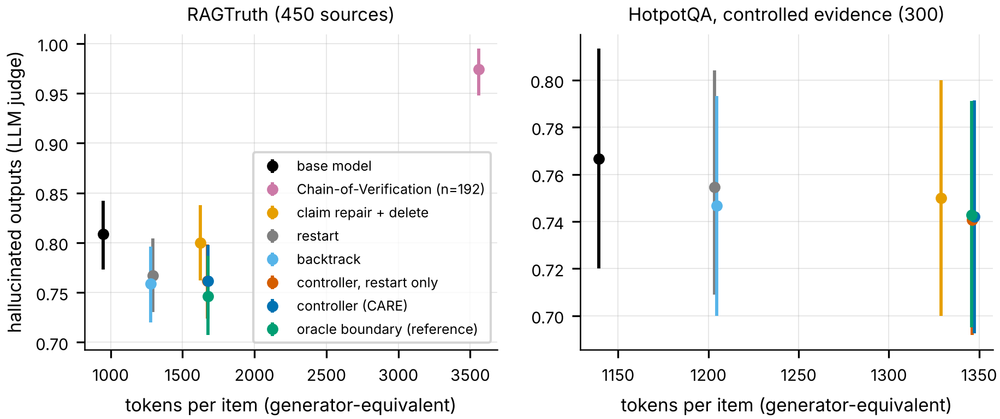

# Run R results: does commitment-aware recovery reduce hallucinations?

Plan: [`PREREGISTRATION_RECOVERY.md`](PREREGISTRATION_RECOVERY.md), committed before any data.
Code: `src/recovery/`, `scripts/30-40`. Raw outputs: `results/recovery/run/`. Every number below
comes from `results/recovery/final/` (`summary.csv`, `tests.json`, `mechanism/summary.json`,
`cove_sensitivity.json`). Generator: Llama-2-7B-chat. Kaggle, 2x T4, 2026-10-25/26.

## Short answer

1. **The system reduces hallucinations relative to the base model**, on both benchmarks
   (preregistered sanity test H0). By the primary evaluator the reduction is modest:
   - RAGTruth: −4.7 points, from 80.9% to 76.2% of outputs, p = 0.0003;
   - HotpotQA: −2.4 points.

   By the second detector it is large (46% → 15%), but that detector shares training data with
   the one the system uses.
2. **It does not beat the simpler alternatives.** Every preregistered comparison against an
   alternative strategy (H1–H5) is **not shown**:
   - Restarting or backtracking with the same detector, at the same budget, is as good and costs
     23–24% fewer tokens (1,293 and 1,279 against 1,677) (equivalent within ±3 points, TOST).
   - The commitment-aware allocation adds nothing over restart-only allocation: −0.000
     [−0.005, +0.005].
   - Even an oracle that knows each boundary's true recoverability gains at most 1.5 points.
3. **Chain-of-Verification is better on hallucination (exploratory).** Its raw outputs look far
   worse, but that is because Llama-2 pastes the verification block into 89% of its answers.
   Counting only the revised answer, CoVe hallucinates in 62% of outputs against 72% for the
   system: difference +0.10 [+0.03, +0.18], p = 0.009, n = 192. CoVe costs about 2x the system's
   tokens per item.
4. **The commitment finding transfers in its "restart is hard to beat" form.** Resampling from just
   before the first human-labelled hallucinated sentence is no better than restarting overall
   (+0.024 [−0.002, +0.049]). It does help for summaries (+0.093 [+0.020, +0.169]) and uses 34%
   fewer continuation tokens. No snowballing was found: keeping the hallucinated sentence does
   not raise the hallucination rate of the rest of the answer.

Evidence levels: (1) and (2) are **preregistered**. (3) and the per-task split in (4) are
**exploratory**.

## Evaluators (checked against human labels before the comparison was read)

Response level, on the 450 released RAGTruth drafts with human span labels:

| Evaluator | Role | F1 | Cohen's κ | flagged / human rate |
|---|---|---|---|---|
| D: LettuceDetect-base | used by the system | 0.747 | 0.511 | 0.46 / 0.50 |
| E2: LettuceDetect-large | secondary evaluator | 0.781 | 0.578 | 0.46 / 0.50 |
| E1: Qwen2.5-7B-Instruct judge | **primary evaluator** | 0.703 | 0.219 | 0.81 / 0.50 |

E1 passes the preregistered bar (F1 ≥ 0.50, κ ≥ 0.20), only just, so it stays primary. It
over-flags: it calls 81% of drafts hallucinated where people say 50%. Absolute rates under E1 are
therefore inflated; differences between policies are the readable quantity. E2 and D share
training data, so E2 favours outputs that D selected. That is why it is not the primary measure.

Judge parse rate: 8,782 of 8,803 verdicts (99.8%). The 21 failures are verdicts cut off on very
long outputs. Those outputs, together with a few too long for the judge's context (50 distinct
outputs in total), use E2's verdict, as preregistered.

## Main results (budget b = 2, primary evaluator E1)

RAGTruth test, 450 sources:

| Policy | Hallucinated (E1) | E2 | Coverage | Tokens / item |
|---|---|---|---|---|
| base model | 0.809 [0.773, 0.842] | 0.460 | 1.000 | 948 |
| delete flagged sentences | 0.796 | 0.131 | 0.998 | 968 |
| claim repair + delete | 0.800 | 0.189 | 0.998 | 1,624 |
| restart until D-clean | 0.767 [0.731, 0.804] | 0.129 | 0.989 | 1,293 |
| backtrack until D-clean | 0.759 [0.720, 0.796] | 0.134 | 0.971 | 1,279 |
| **controller (CARE)** | 0.762 [0.724, 0.798] | 0.153 | 0.965 | 1,677 |
| controller, restart only | 0.762 | 0.151 | 0.967 | 1,672 |
| controller, oracle boundary (not deployable) | 0.746 | 0.152 | 0.954 | 1,677 |
| Chain-of-Verification, raw (n = 192) | 0.974 | 0.724 | 1.000 | 3,558 |
| Chain-of-Verification, before echoed block (n = 192) | 0.620 [0.547, 0.688] | – | 1.000 | 3,558 |
| abstain if flagged (QA), else delete | 0.673 | 0.104 | 0.871 | 968 |

HotpotQA with controlled evidence, 150 questions with sufficient and insufficient passages:

| Policy | Hallucinated (E1) | Correct answer | Correct abstention | Tokens / item |
|---|---|---|---|---|
| base model | 0.767 | 0.213 | 0.000 | 1,139 |
| restart until D-clean | 0.755 | 0.209 | 0.007 | 1,203 |
| backtrack until D-clean | 0.747 | 0.211 | 0.020 | 1,205 |
| controller (CARE) | 0.742 | 0.206 | 0.025 | 1,347 |

Correct answers and correct abstentions are shares of all 300 items. Llama-2 almost never refuses
when the passages lack the answer (base 0 of 150).

## Preregistered tests

Paired by item, source-clustered bootstrap, Holm-adjusted sign-flip p. "Better" required lower
hallucination, Holm p < 0.05 and a coverage loss of less than 2 points.

| | RAGTruth: CARE − reference | coverage | verdict |
|---|---|---|---|
| H0 vs base (sanity) | −0.047 [−0.072, −0.025], p = 0.0003 | −0.035 | **supported** |
| H1 vs restart | −0.005 [−0.024, +0.013] | −0.025 | not shown (TOST: equivalent within ±0.03) |
| H2 vs backtrack | +0.003 [−0.016, +0.021] | −0.006 | not shown |
| H3 vs claim repair + delete | −0.038 [−0.058, −0.020], p = 0.0005 | −0.033 | not shown (coverage loss too large) |
| H4 vs Chain-of-Verification (raw, n = 192) | −0.252 [−0.316, −0.189] | −0.015 | not shown (coverage); and see the formatting artifact above |
| H5 vs restart-only allocation | −0.000 [−0.005, +0.005] | −0.003 | not shown: **the mechanism adds nothing** |

On HotpotQA:
- H0 is supported: −0.024 [−0.044, −0.005].
- H1–H3 and H5 are not shown.
- CoVe was not run, because of the time limit.
- Correct behaviour, meaning answering when the evidence is there and abstaining when it is not,
  is +0.018 against base. That is not significant after Holm correction (p = 0.068).

## Mechanism: is the first hallucinated sentence the point of no return?

226 human-hallucinated RAGTruth drafts and 47 human-clean placebo drafts, 9,696 continuations
sampled from the model that wrote each draft, at the draft's own temperature.

| Quantity | Value |
|---|---|
| clean continuations (E1): restart | 0.167 [0.127, 0.207] |
| clean continuations (E1): just before the first hallucinated sentence | 0.191 [0.146, 0.235] |
| difference | +0.024 [−0.002, +0.049], p = 0.066 |
| by task: Summary / Data2txt / QA | +0.093 [+0.020, +0.169] / +0.019 / −0.034 |
| continuation tokens: restart vs backtrack | 200 vs 132 |
| hazard jump when the hallucinated sentence is kept, minus placebo | −0.006 [−0.029, +0.019] (no snowballing) |
| hallucinated drafts whose restarts are rarely clean (u_0 ≤ 1/8, E2) | 0.115 [0.080, 0.159] |

This mirrors the math study:
- **Where restart won.** For three Qwen models, restarting beat resampling from just before the
  first error.
- **Where it didn't.** For Llama-3.1-8B the two tied. Here, too, the human-labelled first
  hallucination is a fine but not better resampling point.
- **Snowballing.** Once a model has hallucinated, the rest of its answer is not more likely to
  hallucinate. The commitment picture of a trajectory that is doomed after one bad step does not
  describe these hallucinations.

## Latency (measured live, single request, 2x T4)

16 RAGTruth items, 12 of them flagged by the detector. Median seconds of recovery on flagged items:

| | repair + delete | backtrack | controller | restart | CoVe |
|---|---|---|---|---|---|
| median seconds (flagged) | 6.5 | 8.1 | 17.4 | 18.4 | 40.5 |

Drafting the answer itself took a median of 8.7–12.7 s (unflagged / flagged items). When the detector flags nothing, every
detector-triggered policy adds about 0.1 s.

## What this means

- **A detector-triggered loop reduces hallucinations.** With Llama-2-7B, regenerating until a
  RAGTruth-trained detector passes the answer, then abstaining or deleting, reduces
  hallucinations by an amount both evaluators can see.
- **The commitment-based choice does not help.** At equal compute, the choice between repair,
  backtracking and restarting by estimated recoverability does not beat plain restarting or
  backtracking. The oracle bound shows there was little to gain: the recoverability of the two
  boundaries differs too little.
- **CoVe, implemented correctly, is a stronger baseline than it first looked.** A fair comparison
  needs it re-judged with the echoed block removed, and run on all items.

## Limitations and what is not verified

- One generator (Llama-2-7B-chat). The Llama-3.1-8B arm was not run (GPU quota).
- CoVe was run on 192 of 750 items. Its cleaned score comes from sentence verdicts the judge gave
  while seeing the full text.
- The primary judge agrees only moderately with people (κ = 0.22). No human evaluation of the
  system's outputs exists. A blinded comparison kit is in `scripts/38_human_eval_kit.py`.
- Latency comes from 16 items. The replay latency model uses rates measured in the same session.
